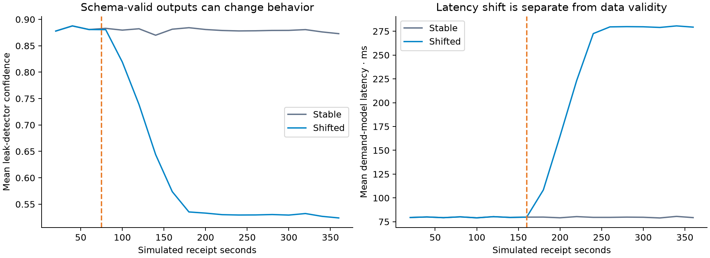
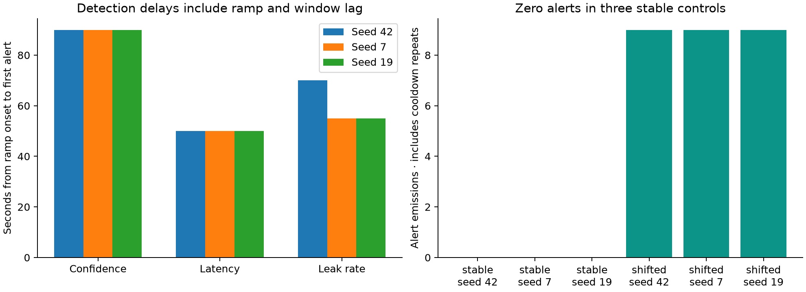
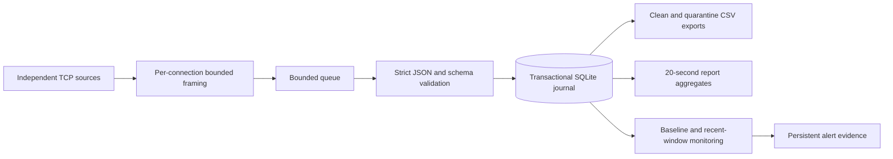

# RillWatch
### Stream Quality & Prediction Observability

[](https://github.com/Pariamazaheri/rillwatch-stream-observability/actions/workflows/ci.yml)


**A durable local pipeline for validating streamed predictions and detecting changes in their behavior.** RillWatch consumes newline-delimited JSON over TCP, separates clean and invalid events, persists their raw bytes and classifications atomically, emits operational reports, and monitors confidence, latency, and label-rate shifts.

This independent portfolio project uses **synthetic water-network telemetry** from three simulated prediction services across ten stations. It demonstrates data engineering and MLOps observability. It does not train models, monitor an actual utility, or claim a customer deployment.

## Measured outcomes

- **86,400 synthetic events** across six reproducible event-clock scenarios, with complete clean/bad accounting.
- All three injected shift types detected in every shifted run; **zero alerts in three stable controls**. These are simulator results, not a universal false-positive guarantee.
- A separate **six-minute real TCP run** checks ingestion, persistence, periodic reporting, and behavior monitoring at the producer's nominal 40 events/second.
- Defensive validation handles wrong JSON types, non-finite numbers, duplicate keys, malformed UTF-8, partial records, and multiple simultaneous errors.
- Local SQLite transactions retain event bytes and classification together; replay of the same source/epoch/sequence is idempotent, with conflicting payloads rejected.




Read the [benchmark and limitations](reports/benchmark.md), [executed walkthrough](notebooks/operations_audit.ipynb), and [correctness review](docs/quality_review.md).

## Architecture



Each source has its own framing state. A single consumer owns the database, counters, and monitoring state. Idle timer ticks keep reports moving when a stream is silent. Time windows use monotonic receipt time; payload timestamps are validated but do not control event ordering. Derived monitoring state resets after restart, while persisted records remain available.

The journal commits each bounded frame together with its validation status under SQLite WAL and `synchronous=FULL`. CSVs are regenerable snapshots, not the durability boundary. This cannot guarantee end-to-end losslessness: a raw TCP producer without acknowledgements and replay can lose bytes before local commit. See the [operating contract](docs/operations.md).

## Methodology

1. Frame incoming byte streams at newline boundaries, preserving fragmented UTF-8 until a complete frame exists. Cap frames at 65,536 bytes. Quarantine oversized prefixes and incomplete trailing frames; resynchronize at the next newline.
2. Validate seven fields and retain all detected failures. Reject booleans as numbers, non-finite values, invalid model/label combinations, duplicate JSON keys, impossible timestamps, and out-of-range station identifiers.
3. Commit the event, raw bytes, source identity, connection epoch, sequence, and classification in one local transaction. Duplicate identities with identical bytes are ignored; collisions with different bytes fail explicitly.
4. Report clean/bad counts, model-specific mean confidence/latency, low-confidence counts, and active valid stations every 20 seconds, including idle windows and a correctly sized final partial window.
5. Freeze the first 60 seconds of each model's valid samples as a baseline. Compare a distinct trailing 45-second window every 15 seconds, requiring at least 50 samples, an effect-size gate, two consecutive checks, and a 60-second per-metric cooldown.
6. Measure stable controls and gradual confidence, latency, and label-rate changes across three seeds. Keep accelerated replay throughput separate from real TCP measurements.

The continuous score divides a mean shift by baseline sample standard deviation. **It is an effect-size heuristic, not a significance test.** Output shifts can result from real network conditions or seasonality; without outcome labels they do not prove model-accuracy or concept drift.

## Project structure

```text
src/rillwatch/   Framing, validation, transactional storage, monitoring, CLI
scripts/        Benchmark, live check, report generation, evidence validation
reports/        Measured results, alert evidence, figures, compact CSV examples
notebooks/      Executed operations walkthrough
data/           Schema contract and synthetic input examples
docs/           Correctness review, architecture tradeoffs, operating contract
tests/          Adversarial, persistence, monitoring, and real loopback tests
```

Full generated data, local journals, environments, and caches stay out of Git. Published clean/bad CSV examples are capped at 25 records each; alert and periodic-report evidence is complete for the reference replay.

## Install

Python 3.11 or 3.12. The installed streaming CLI has **no third-party runtime dependencies**.

```bash
git clone https://github.com/Pariamazaheri/rillwatch-stream-observability.git
cd rillwatch-stream-observability
python -m venv .venv
source .venv/bin/activate
python -m pip install '.[dev,reports]'
```

## Run a live stream

Start the independently written compatibility simulator in one terminal:

```bash
rillwatch serve --seed 42 --port 9034
```

In a second terminal, monitor for six minutes and export its persisted data:

```bash
rillwatch monitor --endpoint water=127.0.0.1:9034 \
  --database data/runs/demo.sqlite --duration 360
rillwatch export --database data/runs/demo.sqlite --output data/runs/demo-csv
```

Repeat `--endpoint source=host:port` to consume multiple independent sources. Source names must be unique. Use `rillwatch serve --stable` for a stable control. The simulator's defaults are 40 nominal events/second and a 2.5% per-event corruption probability; observed rates vary, and the validation logic never assumes a fixed percentage. Scheduling, storage, and backpressure can reduce actual live throughput.

Use a separate database per experiment. On restart, source epochs prevent accidentally merging new records with old identities; active reporting/drift state rewarms, and existing committed data remains in the database.

## Reproduce and verify

```bash
pytest -q
python scripts/validate_results.py
ruff check .
ruff format --check .
python -m build --wheel
```

To generate fresh evidence, use a fresh `data/runs/` location or archive previous generated runs first; benchmark scripts refuse to overwrite an existing experiment database.

```bash
python scripts/benchmark.py
python scripts/live_check.py
python scripts/build_report.py
python scripts/create_notebook.py
python scripts/execute_notebook.py
python scripts/validate_results.py
```

The accelerated benchmark covers 360 simulated seconds per scenario without sleeping. The live check takes approximately six minutes. Notebook execution reads evidence and demonstrates small checks; it does not start a long-running server.

## Operating boundaries

Framing state, the 1,000-frame queue, model-state buffers, and report aggregates are bounded. Each model stores at most 10,000 baseline/recent samples per collection stage; capacity evictions are exposed in report metadata. Capacity-limited monitoring changes the sampled population. Disk retention, broker acknowledgements, cross-host replication, event-time watermarks, seasonality modeling, and authenticated transport are future architecture work. The included loopback simulator is for local use.

Per-frame synchronous commits trade throughput for local persistence. SQLite remains a single-writer local sink. No 50,000-events/second or distributed exactly-once claim is made. Storage failures stop processing; they are never disguised as malformed input. Reports and drift state are derived in memory and are not transactionally checkpointed with every input record.

## References and authorship

[Python asyncio streams](https://docs.python.org/3.12/library/asyncio-stream.html), [JSON parsing](https://docs.python.org/3.12/library/json.html), [SQLite transactions](https://docs.python.org/3.12/library/sqlite3.html), and [SQLite durability settings](https://www.sqlite.org/pragma.html#pragma_synchronous) support the implementation choices. The [design notes](docs/design_notes.md) distinguish implemented behavior from scale-out proposals.

**Author:** [Paria Mazaheri](https://github.com/Pariamazaheri). Code and the new simulator are published under MIT. This independent rebuild used AI assistance for review, implementation, tests, and documentation; experiments were executed locally. No original third-party scripts, source PDFs, private logs, or organization identifiers are redistributed.
